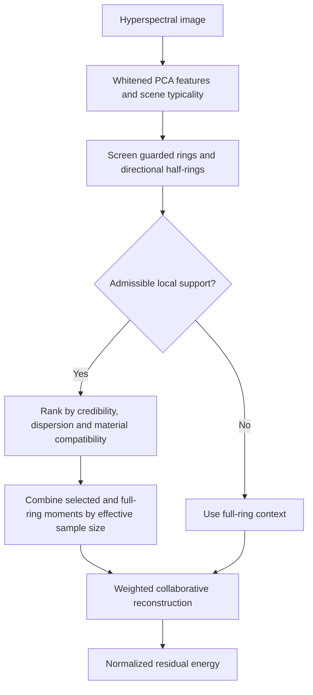

# RANS-HAD

**Reliability-Guided Adaptive Neighborhood Selection for Hyperspectral Anomaly Detection in Heterogeneous Backgrounds**

Xuejin Zhu, LingLong Zhu, and Yitong Zhou

RANS takes a hyperspectral image and assigns an anomaly score to each pixel. It builds a local background reference by screening neighborhoods for typical spectra, low dispersion, and sufficient effective sample size. The repository includes the detector, five comparison methods, and an evaluation workflow for the 13 Airport–Beach–Urban (ABU) scenes. The manuscript cites the original source snapshot [`e448bbb`](https://github.com/zhuxuejin/RANS-HAD/tree/e448bbb2ecc34c59c25b46b2ea3d8b28dbc04722).

## How RANS scores a pixel



The central guard excludes the tested pixel and its immediate neighbors from the local dictionary. When the full context contains fewer than two valid pixels, RANS uses a scene-wide background pool outside the guard. Higher scores indicate stronger anomalies.

## Installation

Clone the repository and install the package using Python 3.10 or later.

```shell
git clone https://github.com/zhuxuejin/RANS-HAD.git
cd RANS-HAD
python -m pip install -e .
```

## Score and evaluate ABU

Download the MAT files separately and place them under `data/ABU/`, keeping their original names, such as `abu-airport-1.mat`. Each file contains a `data` cube with axes **rows × columns × bands** and a binary reference `map`. Scoring uses only the cube. Evaluation uses the reference mask, with one indicating an anomaly. [ABU dataset and MAT files](https://github.com/sxt1996/Airport-Beach-Urban-ABU)

To score **Airport-1 with RANS** and calculate its metrics, run both commands with the same scene and method selection.

```shell
rans-had score --data data/ABU --out runs/airport-1 --methods rans --scenes airport-1
rans-had evaluate --data data/ABU --out runs/airport-1 --methods rans --scenes airport-1
```

For the **full benchmark**, the defaults cover four airport scenes, four beach scenes, and five urban scenes. The six method IDs are `rans`, `crd`, `njcr`, `awcr`, `sp_procrd`, and `krcrd`.

```shell
rans-had score --data data/ABU --out runs/abu
rans-had evaluate --data data/ABU --out runs/abu
```

Use `--methods all` on both commands to include the matched controls and ablations. The original entry point also accepts these commands, for example `python benchmark.py score --data data/ABU --out runs/abu`. Supply method-specific overrides to the scoring command with `--settings examples/settings.json`. [Example settings](examples/settings.json)

Each score map is written to `scores/<method>/<scene>.npy` inside the run directory. Its adjacent JSON file records the effective settings, software versions, and input and output hashes. Evaluation writes `metrics/scene_metrics.csv` and `metrics/macro_metrics.csv`. The reports include AP, AUROC, the false-positive rate at 95% recall, and detection probability at false-positive budgets of 0.1% and 1%. [Evaluation protocol](docs/evaluation.md)

## Python API

```python
from scipy.io import loadmat
from rans_had import detect

cube = loadmat("data/ABU/abu-airport-1.mat", variable_names=["data"])["data"]
scores = detect(cube)  # one continuous score per pixel
```

Use `detect(cube, return_diagnostics=True)` to also obtain the selected radius and direction, support statistics, reference route, and mixing weight. [Standalone scoring example](examples/score_cube.py)

## Source layout

| Path | Contents |
| --- | --- |
| [rans_had/rans.py](rans_had/rans.py) | RANS, fixed-ring controls, GRX-PCA8, and component ablations |
| [rans_had/baselines/](rans_had/baselines/) | CRD, NJCR, AWCR, SP-ProCRD, and KRCRD |
| [rans_had/metrics.py](rans_had/metrics.py) | Empirical ranking and operating-point metrics |
| [rans_had/benchmark.py](rans_had/benchmark.py) | ABU data loading, scoring, and evaluation commands |

## Citation

Use the **Cite this repository** menu on GitHub to export a software citation. [Citation metadata](CITATION.cff)
